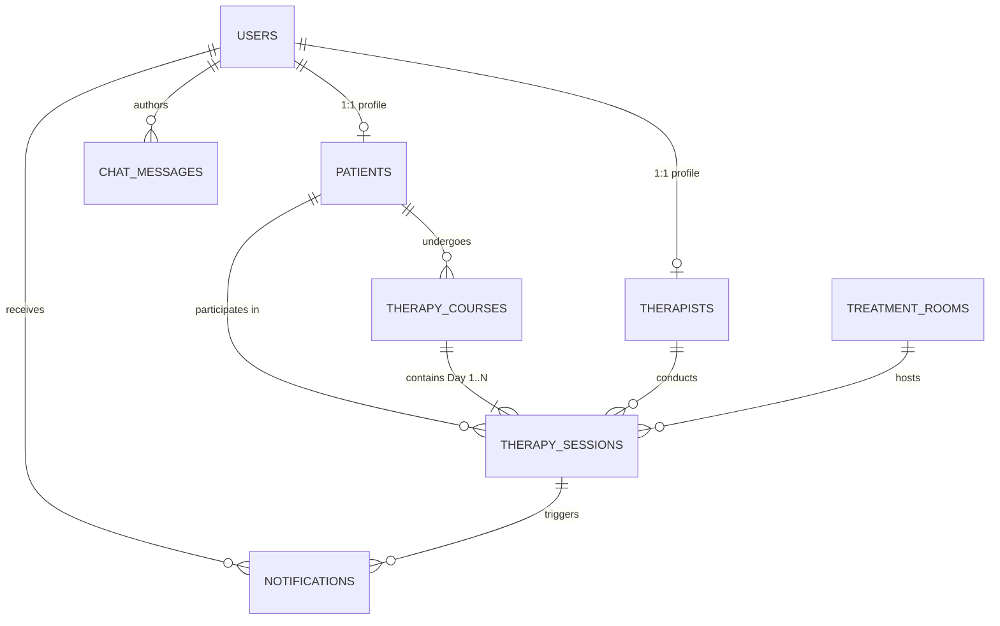
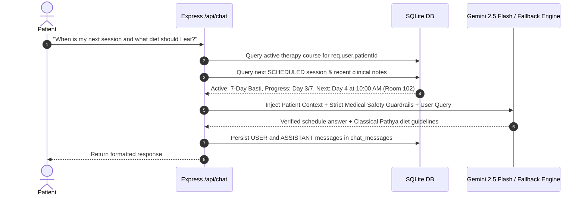

# AYURSUTRA — Architecture & System Design Document

This document details the architectural design, database relationships, multi-day scheduling engine, conflict detection algorithms, transaction boundaries, security model, and AI context flow of **AYURSUTRA**.

---

## 1. High-Level System Architecture

```mermaid
graph TD
    Client["React + TypeScript + Tailwind (Vite - Port 5173)"]
    
    subgraph "Express Backend (Port 5000)"
        Router["Express REST Router (/api)"]
        AuthMid["requireAuth & requireRole Middleware"]
        ValMid["Zod Validation Middleware"]
        SchedService["SchedulingService (Conflict Engine)"]
        ChatService["ChatService (Context Injector & Gemini SDK)"]
        ReminderService["ReminderService (node-cron)"]
        ErrHandler["Centralized Error Handler (409 Conflict, 403, 400)"]
    end
    
    subgraph "Data Tier (Local SQLite)"
        Drizzle["Drizzle ORM Client"]
        SQLite[("data/ayursutra.db (better-sqlite3 with WAL Mode)")]
    end

    Client -->|HTTP REST + HTTP-Only Cookie| Router
    Router --> AuthMid
    AuthMid --> ValMid
    ValMid --> SchedService
    ValMid --> ChatService
    ValMid --> ReminderService
    SchedService -->|Atomic Transaction (BEGIN...COMMIT / ROLLBACK)| SQLite
    ChatService --> Drizzle
    ReminderService --> Drizzle
    Drizzle --> SQLite
    Router --> ErrHandler
```

---

## 2. Database Design & Relational Schema

The database utilizes local **SQLite** accessed through `better-sqlite3` and modeled using **Drizzle ORM** with foreign key constraints and Write-Ahead Logging (WAL) enabled (`PRAGMA foreign_keys = ON; PRAGMA journal_mode = WAL;`).



### Table Breakdown:
1. `users`: Identity and authentication records (`id`, `name`, `email`, `password_hash`, `role: ADMIN | THERAPIST | PATIENT`).
2. `patients`: Demographic and clinical health notes (`id`, `user_id`, `phone`, `date_of_birth`, `gender`, `address`, `medical_notes`).
3. `therapists`: Practitioner specialties and experience (`id`, `user_id`, `specialization`, `phone`, `experience`).
4. `treatment_rooms`: Facility suites (`id`, `room_name`, `room_number`, `description`, `status: ACTIVE | INACTIVE`).
5. `therapy_courses`: Multi-day Panchakarma courses (`id`, `patient_id`, `therapy_name`, `duration_days`, `start_date`, `default_session_time`, `status: ACTIVE | COMPLETED | CANCELLED`).
6. `therapy_sessions`: Discrete daily sessions (`id`, `course_id`, `patient_id`, `therapist_id`, `room_id`, `day_number: 1..N`, `session_date`, `start_time`, `end_time`, `status: SCHEDULED | COMPLETED | MISSED | CANCELLED`, `treatment_notes`, `completed_at`). Unique index on `(course_id, day_number)`.
7. `notifications`: In-app reminders and status alerts (`id`, `user_id`, `session_id`, `title`, `message`, `type`, `is_read`, `scheduled_for`).
8. `chat_messages`: Ayurveda AI conversation logs (`id`, `user_id`, `role: USER | ASSISTANT`, `message`, `created_at`).

---

## 3. Multi-Day Course Scheduling Engine

### The Problem with Single-Session Schedulers:
In standard scheduling apps, booking 14 days requires 14 separate manual entries, resulting in partial bookings if intermediate days clash.

### AyurSutra Scheduling Algorithm:
1. **Input**: Patient $P$, Therapy modality $T$, Duration $N$ days, Start date $D_{start}$, Therapist $Th$, Treatment Suite $R$, Session time $t_{start}$, Duration $\Delta t = 60\text{ mins}$.
2. **Date Vector Computation**:
   $$\text{Dates} = [D_{start}, D_{start} + 1\text{ day}, \dots, D_{start} + (N-1)\text{ days}]$$
3. **Multi-Day Availability Scan**:
   For each day $k \in [1, N]$ and date $d_k$:
   - Calculate $[t_{start}, t_{end}]$.
   - Query existing sessions on $d_k$ where `status != 'CANCELLED'`.
   - **Therapist Overlap Check**:
     $$\text{Conflict}_{Th} \iff s.\text{therapistId} = Th \land (s.\text{startTime} < t_{end} \land s.\text{endTime} > t_{start})$$
   - **Room Overlap Check**:
     $$\text{Conflict}_{R} \iff s.\text{roomId} = R \land (s.\text{startTime} < t_{end} \land s.\text{endTime} > t_{start})$$
4. **Atomic SQLite Transaction Execution**:
   ```sql
   BEGIN TRANSACTION;
   -- 1. Insert Course into therapy_courses
   -- 2. Insert all N sessions into therapy_sessions (Day 1..N)
   -- 3. Insert notification into notifications
   COMMIT;
   ```
5. **Rollback Behavior**:
   If any day has a conflict or fails, `better-sqlite3`'s transaction throws a `SchedulingConflictError`, instantly issuing a `ROLLBACK` and returning an HTTP 409 status code with detailed conflict context.

---

## 4. Role-Based Access Control & Security Model

```mermaid
flowchart TD
    Req["Incoming HTTP Request"] --> AuthMid["requireAuth Middleware"]
    AuthMid -->|Reads token from HTTP-only Cookie / Bearer Header| VerifyJWT["JWT Verification"]
    VerifyJWT --> CheckUser["Query SQLite User Record"]
    CheckUser --> InjectUser["Attach req.user = { userId, email, role, patientId, therapistId }"]
    InjectUser --> RBAC["requireRole(ADMIN | THERAPIST | PATIENT)"]
    
    RBAC -->|ADMIN| AllowAdmin["Access Clinic Management Endpoints"]
    RBAC -->|THERAPIST| AllowTherapist["Access 'My Day' & Clinical Notes Endpoints"]
    RBAC -->|PATIENT| CheckIsolation{"Is Requesting Own Data?"}
    
    CheckIsolation -->|Yes (req.user.patientId matches)| AllowPatient["Access Own Care Journey & AI"]
    CheckIsolation -->|No (Cross-patient tampering)| Reject["Return 403 Forbidden"]
```

### Key Security Safeguards:
- **Zero Plain-Text Passwords**: All credentials hashed with `bcryptjs` (salt rounds: 10).
- **HTTP-Only Cookies**: Prevents Cross-Site Scripting (XSS) token extraction.
- **Server-Side Authorization**: Frontend UI hiding is treated solely as UX; backend enforces mandatory checks on all routes.
- **Strict Data Isolation**: Patient endpoints extract `req.user.patientId` directly from the authenticated session token.

---

## 5. Domain-Restricted AI Architecture & Context Injection


