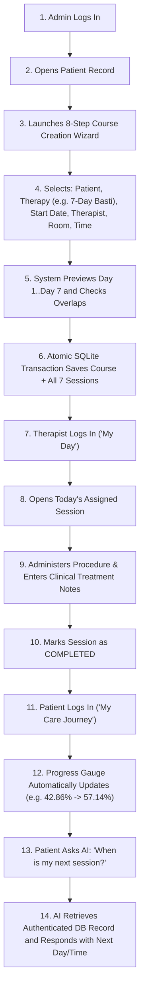

# AYURSUTRA — Complete Project Flow & Interview Guide

This document explains the end-to-end operational workflows of **AYURSUTRA** in clear, simple language and provides interview-ready answers to key software architecture and healthcare scheduling questions.

---

## 1. End-to-End Operational Workflow

---

## 2. Interview-Ready Technical Questions & Explanations

### Q1: What is the core problem AyurSutra solves, and why is Panchakarma scheduling different from normal appointment booking?
> **Answer:**
> Standard healthcare appointment schedulers treat bookings as independent, isolated slots. In Ayurvedic Panchakarma, therapies are **contiguous, multi-day journeys** where the patient undergoes progressive treatment over 5, 7, 14, or 21 continuous days.
>
> If a clinic schedules sessions day-by-day manually, therapists and rooms frequently get double-booked on intermediate days (e.g., Day 4 is busy while Days 1-3 were booked). AyurSutra treats the therapy course as **one connected entity**, atomically generating all daily sessions while scanning the entire multi-day date span for conflicts.

---

### Q2: How does the Multi-Day Scheduling Engine generate Day 1 through Day N sessions?
> **Answer:**
> Given a start date $D_{start}$, duration $N$, and session start time $t_{start}$:
> 1. The engine calculates end time $t_{end} = t_{start} + 60\text{ minutes}$.
> 2. For each day index $i \in [0, N-1]$, the session date is computed as $D_{start} + i\text{ days}$.
> 3. Day number is assigned as $i + 1$.
> 4. All sessions are bound by foreign key to the parent `therapy_courses.id` and assigned the default status `SCHEDULED`.

---

### Q3: How do you detect and prevent double-booking conflicts across the entire course?
> **Answer:**
> Before inserting any record, the system queries existing non-cancelled sessions on each computed session date.
> An overlap conflict exists if:
> $$\text{existing.start\_time} < \text{new.end\_time} \quad \text{AND} \quad \text{existing.end\_time} > \text{new.start\_time}$$
> We evaluate this condition for both:
> 1. **Therapist Overlap**: The practitioner is already engaged in another therapy.
> 2. **Room Overlap**: The treatment suite is already occupied.
>
> If any conflict is found on any day (e.g., Day 3 of 7), a structured `409 Conflict` error is returned detailing the exact conflicting date, time, resource type, and resource name.

---

### Q4: How does Atomic Database Transaction Rollback work in SQLite?
> **Answer:**
> We wrap course insertion and session generation inside a native SQLite transaction (`sqlite.transaction(...)`).
>
> If Day 1, 2, and 3 are free, but Day 4 triggers a conflict, the code throws an exception inside the transaction function. SQLite automatically rolls back the entire transaction. **Neither the course nor any intermediate sessions remain in the database**. Our Vitest test suite explicitly verifies this by creating an obstacle on Day 4 and asserting that zero residual records exist after rejection.

---

### Q5: How does Patient Data Isolation work?
> **Answer:**
> Data isolation is enforced strictly on the server side:
> 1. When a user logs in, a signed JWT containing their `userId`, `role`, and `patientId` is stored in an HTTP-only cookie.
> 2. For all patient portal endpoints (`/api/patient/dashboard`, `/api/patient/course`, `/api/chat`), the backend queries records using `req.user.patientId` extracted from the verified token.
> 3. If a patient attempts to access `/api/patients/:id` with another patient's ID, the controller explicitly checks `req.user.patientId !== req.params.id` and returns `403 Forbidden`.

---

### Q6: How does the AI Assistant retrieve authenticated patient schedule information safely?
> **Answer:**
> The frontend never sends client-controlled patient data to the AI. Instead:
> 1. When a patient submits a chat message to `POST /api/chat`, the backend verifies the user's JWT.
> 2. The backend queries SQLite for the patient's active course, completed session count, and the next `SCHEDULED` session.
> 3. This verified data is injected into a strict system prompt along with medical safety guardrails (prohibiting medical diagnoses and drug prescriptions).
> 4. Gemini 2.5 Flash processes the query and answers with verified clinic dates and classical Ayurvedic advice (Pathya/Apathya).
> 5. If no API key is provided, an intelligent domain fallback uses the same verified database context to answer accurately.

---

### Q7: How is dynamic patient progress calculated?
> **Answer:**
> Progress is never hardcoded. It is calculated dynamically from SQLite session states:
> $$\text{Progress Percentage} = \frac{\text{Completed Sessions}}{\text{Total Course Duration}} \times 100$$
> When a therapist marks a session `COMPLETED`, the next page refresh or TanStack Query invalidation recalculates the progress (e.g., $3/7 = 42.86\% \rightarrow 4/7 = 57.14\%$). When all sessions reach `COMPLETED`, the course status automatically transitions from `ACTIVE` to `COMPLETED`.

---

### Q8: Why SQLite and Drizzle ORM?
> **Answer:**
> 1. **Zero External Server Dependency**: SQLite runs in-process via `better-sqlite3`, making the application instantly runnable locally without requiring PostgreSQL or database server daemons.
> 2. **ACID Transactions**: SQLite provides robust atomic transactions (`WAL` mode + `PRAGMA foreign_keys = ON`) ensuring consistency during multi-day scheduling.
> 3. **Type-Safe ORM**: Drizzle ORM gives full TypeScript type inference, zero runtime overhead, and explicit relational queries.
